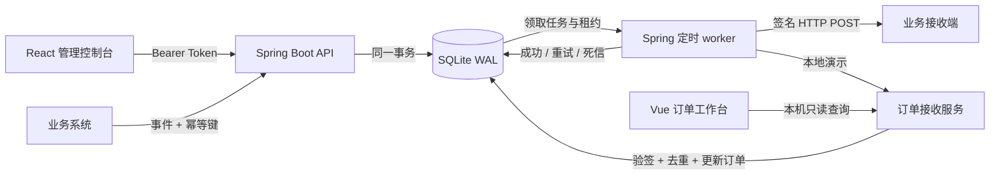

<div align="center">

# RelayForge

**让每一次 Webhook 投递，都有迹可循。**

Spring Boot 可靠投递后端 · React 管理控制台 · Vue 3 订单接收示例

Java 17 · Spring Boot 3.5 · SQLite · React · Vue · TypeScript

[快速启动](#快速启动) · [架构与取舍](docs/ARCHITECTURE.md) · [完成后学习路线](docs/LEARNING_PATH.md)

</div>

---

订单创建后通知业务系统、订阅更新后触发自动化——这些场景都需要把事件可靠地发给 HTTP 接收端。RelayForge 把这条链路做成一个可运行的项目：**提交事件 → 事务落库 → 后台投递 → 签名验证 → 重试或死信 → 排查与重放**。

当前主实现为 **Java / Spring Boot**。已有 React 界面继续通过同一套 HTTP API 工作；新增 Vue 订单工作台，展示接收端验签、事件去重和业务写入的结果。原 Node / Fastify 后端及测试保留在 `server/`、`tests/`，作为旧版参考，主启动流程不会运行它们。React 暂时继续引用 `server/types.ts` 中的接口类型，这不会启动 Node 后端。


## 项目能力

| 能力 | 实现 |
| --- | --- |
| 持久化任务 | Spring JDBC + SQLite；事件和投递任务在同一个事务中创建 |
| 幂等提交 | `Idempotency-Key` 防止重复建单；同键不同内容返回冲突 |
| 重试与死信 | 暂时性失败采用指数退避与随机抖动；耗尽次数后进入死信 |
| 任务恢复 | 短事务领取、租约过期恢复、令牌校验防止旧结果覆盖 |
| 安全投递 | HMAC-SHA256、目标地址和 DNS 校验、超时、响应体大小限制 |
| React 管理台 | 端点启停、事件发布、状态筛选、尝试记录和手动重放 |
| Vue 接收示例 | 展示订单及接收记录；业务处理和去重在后端事务中完成 |
| 本地演示 | 正常、暂时失败、永久拒绝、订单接收四种目标 |

## 快速启动

准备 **JDK 17–25、Maven 3.6.3+、Node.js 24.x 与 npm**。Java 编译目标为 17；数据库使用 SQLite JDBC，无需安装数据库服务器。以下命令均从仓库根目录执行。

```bash
git clone https://github.com/huangyuke914235/program.git relayforge
cd relayforge
npm ci
npm --prefix receiver-ui ci
npm run setup
npm run build
npm start
```

`npm run build` 依次构建 React、Vue 和 Spring Boot JAR。`npm start` 从仓库根目录运行 `java/target/relayforge-2.0.0.jar`，Spring Boot 读取根目录的 `.env`，并提供 `dist/web` 中的 React 静态页面。

1. `npm run setup` 创建 `.env` 并显示随机管理 Token；已有配置会保留。
2. 打开 **[http://127.0.0.1:3000](http://127.0.0.1:3000)**，粘贴 Token 连接工作区。
3. 创建演示数据：系统会注册四个演示端点，发布一个 `order.created` 事件。
4. 查看暂时失败端点如何重试成功，以及永久拒绝端点如何进入死信。
5. 点击投递记录，检查 HTTP 状态、尝试历史与原始载荷。

API 文档位于 **[http://127.0.0.1:3000/api/docs](http://127.0.0.1:3000/api/docs)**。`.env`、数据库、构建输出和缓存已加入忽略规则。

### 打开 Vue 订单工作台

保持 Java 服务运行，另开终端执行：

```bash
npm run dev:receiver
```

访问 **[http://127.0.0.1:5174](http://127.0.0.1:5174)**。页面通过 Vite 代理访问 Java 的 `/receiver/api/orders` 和 `/receiver/api/receipts`，每 5 秒读取真实业务数据。先在 React 控制台创建演示数据，订单便会出现。

该示例要求本地 Java 服务启用 `DEMO_MODE=true`（`npm run setup` 的默认设置），接收查询仅对本机开放。Vue 的生产文件会构建到 `receiver-ui/dist`，目前未打包进 Spring Boot；当前演示入口为独立 Vite 服务。

### 开发模式

首次安装两个前端的依赖并生成 `.env` 后，打开三个终端：

```bash
# 终端 1：Spring Boot API 与进程内 worker
npm run dev
```

```bash
# 终端 2：React 管理界面
npm run dev:web
```

```bash
# 终端 3：Vue 订单接收界面
npm run dev:receiver
```

React 开发地址为 [http://127.0.0.1:5173](http://127.0.0.1:5173)，Vue 为 [http://127.0.0.1:5174](http://127.0.0.1:5174)。两个前端都将请求代理到 Java 的 `3000` 端口。后端代码修改后需重启开发进程；前端由 Vite 热更新。

### Docker

```bash
npm run setup
docker compose up --build -d
```

Docker 构建 React 静态文件和 Spring Boot JAR，运行时使用 JRE 17 与非 root 用户。访问 [http://127.0.0.1:3000](http://127.0.0.1:3000)，使用 `.env` 中的 Token。SQLite 存储在命名卷 `relayforge-data`，`docker compose down` 会保留数据。

容器仅向本机发布端口，不包含 Vue 服务。需要观察 Vue 的完整本地示例时，使用前面的 Java 本机启动方式；接收查询的 loopback 限制不适合通过 Docker 网络转发访问。Docker 配置已提供，实际构建需要本机安装 Docker。

## 工作原理



接收消息示例：

```json
{
  "id": "event-id",
  "type": "order.created",
  "createdAt": "2026-10-31T08:00:00.000Z",
  "data": { "orderId": "ORD-1001", "amount": 29900, "currency": "CNY" }
}
```

签名请求头为 `webhook-id`、`webhook-delivery-id`、`webhook-timestamp` 和 `webhook-signature`。接收方必须验签并持久化去重；详见[签名协议](docs/ARCHITECTURE.md#签名协议)。

## 目录与验证命令

```text
java/                  Spring Boot API、JDBC Store、worker、Java 测试
web/                   React 管理界面
receiver-ui/           Vue 3 订单接收界面
server/、tests/         旧 Node 实现及其测试，仅供参考
scripts/setup.mjs      本地配置与随机 Token 初始化
docs/                  架构说明与学习路线
.github/workflows/     Java、双前端、旧版参考的分开验证
```

```bash
npm test                    # Java / Spring Boot 测试
npm run build:web           # React 类型检查与生产构建
npm run build:receiver      # Vue 类型检查与生产构建
npm run build:java          # Maven 测试并打包 JAR
npm run check               # Java 测试 + 两个前端的类型检查与构建
npm run test:legacy         # 旧 Node 参考实现的测试，不能证明 Java 实现正确
```

CI 分开执行 Maven `verify`、React/Vue 构建与旧 Node 参考测试。Java 测试位于 `java/src/test/java`；旧版测试数量和通过情况不代表新版后端的覆盖范围。

## 配置

| 环境变量 | 默认值 / 要求 | 用途 |
| --- | --- | --- |
| `API_TOKEN` | 必填，至少 32 个字符 | 单工作区管理认证，建议随机生成 |
| `HOST` | `127.0.0.1` | Java 监听地址；容器内设为 `0.0.0.0` |
| `PORT` | `3000` | Java HTTP 端口；前端开发代理默认使用此端口 |
| `DATABASE_PATH` | `data/relayforge.sqlite` | 相对根目录的 SQLite 路径 |
| `DEMO_MODE` | `false` | 本地接收端与订单查询；setup 为本机演示设为 `true` |
| `WORKER_ENABLED` | `true` | 启用 Spring 进程内的定时 worker |
| `RETRY_BASE_MS` | `1000` | 自动重试基础退避时间 |

Spring Boot 通过 `spring.config.import=optional:file:.env[.properties]` 读取根目录配置，系统环境变量可覆盖它。Java 版目前没有独立 worker 命令；关闭 `WORKER_ENABLED` 后，任务会留在数据库中等待后续处理。

## 迁移与使用边界

当前主流程已经切换到 Java。Node 旧代码与依赖暂时保留以便对照，带 `:legacy` 的命令会运行旧实现。**不要同时启动两种后端并让它们写入同一个数据库。** Java 沿用原有核心数据表结构，但跨语言 JSON 规范化、历史幂等记录和异常边界仍需单独验证，不能据此保证无条件迁移兼容。使用已有数据前先停止旧进程并备份数据库；建议先用独立数据库验证。

这是一个单机、单工作区工程项目，没有用户注册、多租户隔离和 RBAC，也没有承诺跨主机调度或高吞吐。Vue 接收服务与投递系统位于同一个 Spring Boot 应用中，目的是演示完整链路；它不是独立部署的业务服务。

投递采用 **at-least-once（至少一次）** 语义。接收方已经提交业务事务而发送方尚未记录成功时，崩溃可能导致再次投递；接收方必须幂等。暂停端点阻止后续任务领取，已在进行的 HTTP 请求仍可能完成。

对外部署前关闭 `DEMO_MODE`，使用 HTTPS 反向代理并限制管理入口。端点密钥保存在数据库中，当前没有应用层加密和密钥轮换。事件载荷与响应片段也可能包含敏感信息，需要保护数据卷和备份。

## License

[MIT](LICENSE)
