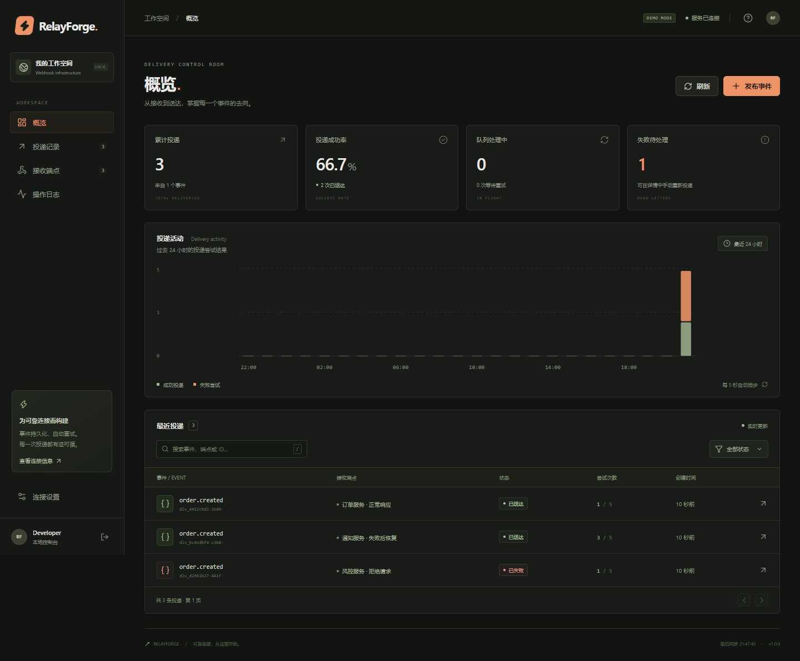
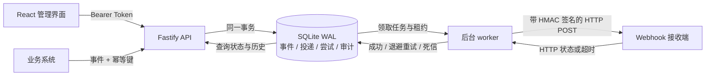

<div align="center">

# RelayForge

**让每一次 Webhook 投递，都有迹可循。**

一个可以本地运行、观察失败并手动恢复的可靠 Webhook 投递平台。

TypeScript · Fastify · SQLite · React

[快速启动](#快速启动) · [架构与取舍](docs/ARCHITECTURE.md) · [完成后学习路线](docs/LEARNING_PATH.md)

</div>

---

订单支付后通知库存系统、订阅更新后通知业务服务、构建结束后触发自动化——这些场景都需要把一个事件可靠地发送到 HTTP 接收端。接收端超时或暂时不可用时，事件应该留下来，系统应该自动重试，开发者应该看得见发生了什么。

RelayForge 把这条完整链路做成了一个可运行的工程项目：**提交事件 → 事务落库 → 后台投递 → 签名验证 → 重试或死信 → 管理界面排查与重放**。



## 已实现的能力

| 能力         | 在项目中的表现                                                     |
| ------------ | ------------------------------------------------------------------ |
| 持久化任务   | 事件与投递任务在同一个 SQLite 事务中创建；进程重启后可以继续处理   |
| 幂等提交     | `Idempotency-Key` 防止重复创建事件；同一个键对应不同内容时返回冲突 |
| 重试与死信   | 网络异常和暂时性 HTTP 错误按指数退避重试；达到上限后进入死信状态   |
| 安全投递     | HMAC-SHA256 签名、目标地址校验、私网地址限制、超时与响应体大小限制 |
| 任务抢占     | 数据库事务领取任务，租约过期后恢复，并阻止旧 worker 覆盖新结果     |
| 可操作的界面 | 投递状态、活动趋势、尝试记录、事件载荷、端点启停、手动重放         |
| 本地演示     | 内置成功和暂时失败的接收端，不需要第三方账号即可观察重试流程       |
| 工程交付     | 严格 TypeScript、自动化测试、GitHub Actions、Docker 与中文文档     |

## 快速启动

需要 **Node.js 24.x** 和 npm。项目使用 Node 内置的 `node:sqlite`，无需安装数据库服务。

```bash
git clone https://github.com/huangyuke914235/program.git relayforge
cd relayforge
npm ci
npm run setup
npm run build
npm start
```

1. `npm run setup` 创建本地 `.env`，并显示随机生成的管理 Token。已有 `.env` 会保留。
2. 打开 **[http://127.0.0.1:3000](http://127.0.0.1:3000)**，粘贴 Token 连接工作区。
3. 在界面中创建演示数据，观察投递从排队、重试到成功的变化。
4. 点击投递记录，查看 HTTP 状态、每次尝试和事件载荷。

API 文档位于 **[http://127.0.0.1:3000/api/docs](http://127.0.0.1:3000/api/docs)**。`.env` 与 `data/` 已加入 Git 忽略规则，请勿上传真实 Token、签名密钥或业务事件。

### 开发模式

首次执行 `npm ci` 和 `npm run setup` 后，打开两个终端：

```bash
# 终端 1：后端与内置 worker
npm run dev
```

```bash
# 终端 2：Vite 前端
npm run dev:web
```

访问 [http://127.0.0.1:5173](http://127.0.0.1:5173)，Vite 会将 `/api` 请求代理给 `3000` 端口。修改后端代码后需重启 `npm run dev`；前端由 Vite 热更新。

### Docker

```bash
npm run setup
docker compose up --build -d
```

仍然访问 [http://127.0.0.1:3000](http://127.0.0.1:3000)，使用 `.env` 中的 Token。数据库存储在 Docker 命名卷 `relayforge-data`；执行 `docker compose down` 会保留数据。Docker 配置使用非 root 用户运行，默认仅向本机开放端口。

## 工作原理



接收方收到的消息格式：

```json
{
  "id": "event-id",
  "type": "order.paid",
  "createdAt": "2026-10-29T08:00:00.000Z",
  "data": { "orderId": "ORD-1001", "amount": 29900, "currency": "CNY" }
}
```

请求头包含 `webhook-id`、`webhook-delivery-id`、`webhook-timestamp` 和 `webhook-signature`。接收方需要使用端点密钥验证签名，并对事件去重；完整协议见[架构文档](docs/ARCHITECTURE.md#签名协议)。

## 项目结构

```text
server/          API、持久化、任务处理和安全投递
web/             React 管理界面
tests/           事务、幂等、重试、安全边界等测试
scripts/setup.mjs 本地配置与随机 Token 初始化
docs/            架构说明与后续学习路线
.github/         持续集成
```

```bash
npm test              # 自动化测试
npm run typecheck     # 前后端严格类型检查
npm run build         # 编译后端并构建前端
npm run check         # 类型检查 + 测试 + 构建；CI 同样执行
```

当前包含 46 项自动化测试，覆盖事务回滚、幂等冲突、真实双进程抢占、租约恢复、签名、私网地址限制和真实 HTTP 投递。管理界面已通过浏览器操作验收。Docker 配置已提供，但未在本次开发环境中实际运行。

## 配置

| 环境变量         | 默认值 / 要求            | 用途                                            |
| ---------------- | ------------------------ | ----------------------------------------------- |
| `API_TOKEN`      | 必填，至少 32 个字符     | 单工作区管理认证；建议由 setup 随机生成         |
| `HOST`           | `127.0.0.1`              | 监听地址；容器内使用 `0.0.0.0`                  |
| `PORT`           | `3000`                   | HTTP 端口                                       |
| `DATABASE_PATH`  | `data/relayforge.sqlite` | SQLite 数据库路径                               |
| `DEMO_MODE`      | `false`                  | 启用本地演示接收端；setup 为本机演示设为 `true` |
| `WORKER_ENABLED` | `true`                   | 是否在 API 进程内启动 worker                    |
| `RETRY_BASE_MS`  | `1000`                   | 自动重试的基础退避时间                          |

本地可用 `WORKER_ENABLED=false` 启动 API，并运行 `npm run worker` 单独启动 worker。多个进程必须位于同一主机、使用同一个数据库文件。生产构建也可运行 `node --env-file-if-exists=.env dist/server/worker-cli.js`。

## 适用范围与边界

这是一个**完成业务闭环的单机工程项目**，适合学习后端可靠性和作为作品集展示。它使用单工作区管理 Token，没有多租户隔离、用户注册或 RBAC。SQLite 适合这个规模的持久化队列，当前实现没有承诺跨主机调度或高吞吐分布式处理。

投递采用 **at-least-once（至少一次）** 语义：如果接收端已处理事件、发送方尚未记录成功时进程崩溃，事件可能再次送达。接收方必须幂等。端点暂停会阻止后续领取任务，已开始的 HTTP 请求仍可能完成。

演示模式只为内置接收端开放有限的本机地址例外；正常投递会拒绝私网目标。对外部署前关闭 `DEMO_MODE`，配置 HTTPS 反向代理，限制管理入口并保护数据库卷。签名密钥保存在本地数据库中，当前版本没有应用层密钥加密和密钥轮换功能。

项目完成后，可以从[学习路线](docs/LEARNING_PATH.md)开始：先亲手复现一次失败与恢复，再沿着实际代码理解事务、幂等、任务租约和签名。

## License

[MIT](LICENSE)
