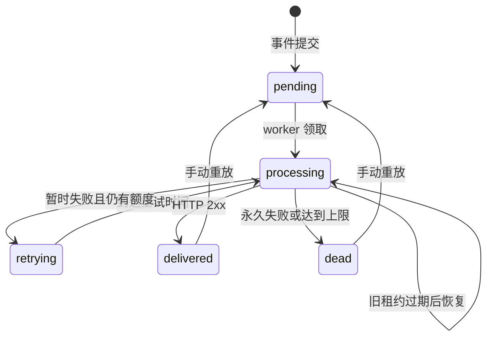

# RelayForge 架构与工程取舍

RelayForge 把一个入站业务事件持久化为若干投递任务，再通过后台 worker 将它发送给 HTTP 接收端。管理界面调用同一套 API 展示任务状态和尝试历史。

## 组件边界

| 组件         | 职责                                                     |
| ------------ | -------------------------------------------------------- |
| Fastify API  | 认证、输入校验、端点管理、事件提交、查询与手动重放       |
| SQLite Store | 事务、一致性约束、幂等记录、任务领取和状态持久化         |
| Worker       | 领取到期任务、签名、调用传输层、分类结果和安排下一次尝试 |
| HTTP 传输层  | 目标地址校验、DNS 与连接控制、超时、响应大小限制         |
| React 界面   | 展示实际 API 数据，创建端点和事件，排查失败并执行重放    |

API 与 worker 可以在同一个进程内运行，也可以通过 `WORKER_ENABLED=false` 和独立 worker 进程分开。数据库文件是它们之间的持久化边界。

## 从一次提交到一次投递

1. 客户端携带 `Authorization: Bearer <token>` 和 `Idempotency-Key` 提交事件。
2. Store 在一个事务里检查幂等键、写入事件并写入所有目标端点的投递任务。
3. worker 使用数据库事务领取一个到期任务，同时记录租约和本次尝试。
4. worker 在事务外执行 HTTP POST；网络等待不会占住数据库写事务。
5. HTTP 结果持久化为成功、等待重试或死信。状态回写需要匹配当前租约，防止旧 worker 覆盖新 worker 的结果。

事件和任务一起提交解决了“事件已经保存，但任务没有创建”的双写问题。这里使用 SQLite 表作为持久化队列，没有引入独立消息代理。

## 幂等的范围

同一个 `Idempotency-Key` 和相同的事件内容会返回既有事件，不创建新的投递任务。相同键携带不同内容会返回冲突。载荷对象的键顺序不应改变幂等判断；显式目标端点集合也应规范化。

幂等键保护的是**事件创建操作**。它不能保证接收方只处理一次 HTTP 请求。接收方应对 `webhook-id` 建立持久化去重约束；如果同一事件会进入多个订阅端点，去重键应包含订阅/端点标识。

## 投递状态



默认一轮最多尝试 5 次。网络错误、超时、HTTP `408`、`425`、`429` 和 `5xx` 可重试；其他非 `2xx` 响应视为终止失败。重定向不会自动跟随。重试使用带随机抖动的指数退避，等待时间封顶，减少多个失败任务同时冲击接收方的机会。

手动重放只接受已成功或已死信的任务，保留历史记录并重新开始一轮尝试。它使用同一个事件 ID，因此具备去重逻辑的接收方可能直接忽略已经处理过的事件；“重放”并不强制再次产生业务副作用。

## 租约、恢复与至少一次语义

领取任务时，短事务设置租约令牌和到期时间。没有崩溃时，该 worker 在网络超时界限内结束投递并持久化结果。如果进程消失，其他 worker 可在租约过期后恢复该任务。回写结果时必须核对令牌，旧 worker 即使稍后恢复，也不能覆盖新租约下的状态。

这保障任务不会因为进程退出而永久卡住，但不能把远端业务事务与本地事务合为一个原子操作：

```text
接收方处理成功 → 发送方进程崩溃 → 本地成功状态未写入 → 任务重试
```

因此本项目采用至少一次投递语义。接收方的幂等处理是协议的一部分。

## 签名协议

每个端点有独立签名密钥。创建端点时 API 只在创建响应中返回密钥，常规列表不返回密钥。

| 请求头                | 内容                                |
| --------------------- | ----------------------------------- |
| `webhook-id`          | 事件 ID；自动重试和手动重放保持相同 |
| `webhook-delivery-id` | 投递任务 ID                         |
| `webhook-timestamp`   | 当前尝试的 Unix 秒级时间戳          |
| `webhook-signature`   | `v1=` 加十六进制 HMAC-SHA256        |

待签名消息是 **时间戳字符串 + `.` + 原始 HTTP 请求体**。不能先解析 JSON 再重新序列化后验证，因为空格和字段顺序都可能改变字节。

```js
import { createHmac, timingSafeEqual } from "node:crypto";

export function verifyWebhook({ rawBody, timestamp, signature, secret }) {
  if (!/^\d+$/.test(timestamp ?? "")) return false;
  // 示例窗口为 5 分钟；部署时确保接收方时钟同步。
  if (Math.abs(Date.now() / 1000 - Number(timestamp)) > 300) return false;
  if (!/^v1=[a-f0-9]{64}$/.test(signature ?? "")) return false;
  const expected = createHmac("sha256", secret)
    .update(`${timestamp}.${rawBody}`)
    .digest();
  const actual = Buffer.from(signature.slice(3), "hex");
  return actual.length === expected.length && timingSafeEqual(actual, expected);
}
```

生产接收端还应限制请求体大小、拒绝缺失或重复的签名头，并先验证签名再处理业务。签名验证通过后，仍需要持久化事件去重，时间窗口本身无法避免窗口内的重放。

## 出站请求安全

Webhook 目标由用户输入，因此 HTTP 客户端不能直接无条件访问任意地址。目标 URL 和 DNS 解析结果都需要校验，私网、回环、链路本地等非公网地址默认拒绝；连接应使用已校验的目标地址，以避免校验之后重新解析到其他地址。重定向不自动跟随。

演示模式为内置的本机接收端提供严格限定的例外，用于在没有互联网的情况下展示成功和重试。这个例外不是允许任意访问内网的开关；对外部署请关闭 `DEMO_MODE`。

## 数据与密钥

数据库保存事件原始载荷、目标地址、投递结果和端点签名密钥。响应体只保留受限的片段，错误信息也会限制长度。事件载荷和响应片段仍可能包含业务敏感信息，卷权限、备份与数据保留策略由部署者负责。

管理 API 使用单个共享 Token，前端保存在当前浏览器会话存储中。当前版本不支持多用户权限隔离、自动凭据轮换或应用层密钥加密，不能据此宣称具备完整的多租户平台安全能力。

## 为什么选择这些技术

- **TypeScript 全栈**：API 与界面共享一种语言，严格类型检查有助于控制接口变更。
- **Fastify**：提供路由、结构化日志和测试注入能力；核心业务逻辑仍放在独立 Store/worker 中。
- **SQLite WAL**：无需外部数据库，事务和约束足以支撑单机队列。短同步查询易于审计，但写入并发、事件循环阻塞和单文件存储都是扩展边界。
- **React + Vite**：支持状态驱动的操作界面，开发服务器与生产静态资源构建方式清晰。

当事件量或租户数量增长时，合理的下一步是先补监控与容量测量，再评估 PostgreSQL、独立消息队列、密钥管理服务和租户模型，而不是只替换数据库名称。
