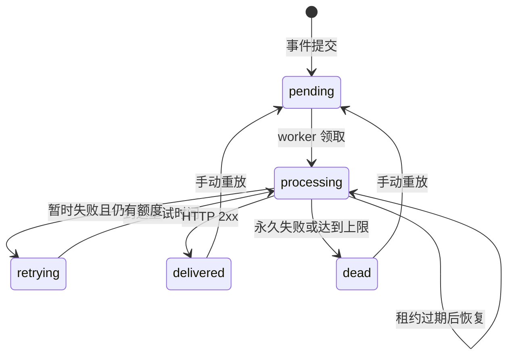

# RelayForge 架构与工程取舍

主实现由 Spring Boot 提供 API、SQLite 持久化队列、定时 worker 和本地订单接收示例。React 是管理端，Vue 是接收业务的展示端。两个前端都只通过 HTTP 访问后端，不直接访问数据库。

## 组件边界

| 组件 | 代码入口 | 职责 |
| --- | --- | --- |
| REST API | [ApiController.java](../java/src/main/java/com/relayforge/api/ApiController.java) | 端点、事件、投递、审计与演示数据 |
| 认证与请求边界 | [AccessFilter.java](../java/src/main/java/com/relayforge/api/AccessFilter.java) | Bearer Token、基础限流、请求限制和本地演示访问控制 |
| JDBC Store | [RelayStore.java](../java/src/main/java/com/relayforge/store/RelayStore.java) | 事务、幂等、领取、租约与完成状态 |
| 数据结构 | [Models.java](../java/src/main/java/com/relayforge/store/Models.java) | 前后端交换的事件、端点、投递和尝试记录 |
| Worker | [DeliveryWorker.java](../java/src/main/java/com/relayforge/worker/DeliveryWorker.java) | 定时领取任务、签名、调用传输层与安排重试 |
| HTTP 传输 | [PinnedHttpTransport.java](../java/src/main/java/com/relayforge/worker/PinnedHttpTransport.java) | DNS 校验和固定地址连接、超时、响应大小限制 |
| 签名与地址策略 | [WebhookSecurity.java](../java/src/main/java/com/relayforge/worker/WebhookSecurity.java) | HMAC 验签与目标 URL 检查 |
| 业务接收示例 | [DemoReceiver.java](../java/src/main/java/com/relayforge/api/DemoReceiver.java) | 演示验签、去重、订单写入和本机只读查询 |
| React 管理台 | [web/](../web/) | 配置端点、发布事件、排查投递和重放 |
| Vue 订单工作台 | [receiver-ui/](../receiver-ui/) | 查询订单与接收记录，展示实际处理结果 |

当前 worker 在 Spring 进程内由调度器执行。`WORKER_ENABLED=false` 会关闭它；Java 版尚无独立 worker 启动命令。保留的 `server/` 是旧 Node 参考实现，不是当前主服务的一部分。

## 从一次提交到一次投递

1. 业务客户端携带管理 Token 与 `Idempotency-Key` 提交事件。
2. Store 在同一事务内检查幂等键、写入事件并为目标端点创建投递任务。
3. worker 在短事务内领取一个到期任务，记录租约令牌和本次尝试。
4. 在事务外构造消息、计算签名并发送 HTTP POST。
5. 根据结果将任务标记为成功、等待重试或死信。回写必须匹配当前租约令牌。

事件与任务一起提交，避免出现“事件保存了但任务丢了”的双写缺口。SQLite 表承担持久化队列的作用，没有另设消息代理。HTTP 请求不放在数据库事务中，避免网络等待长期占用写锁。

## 幂等与事务

相同 `Idempotency-Key` 和相同事件内容会返回已有事件，不重复创建任务。相同键用于不同内容则返回冲突。载荷对象键顺序和显式端点集合会进行规范化后参与指纹计算。

这保护的是**事件创建操作**，无法保证远端只产生一次业务副作用。自动重试和手动重放都可能再次送达同一事件。接收方需要持久化去重；同一服务有多个订阅时，去重键通常应包含订阅/端点标识。

## 投递状态



默认每轮最多尝试 5 次。网络错误、超时、HTTP `408`、`425`、`429` 与 `5xx` 可重试；其他非 `2xx` 结果终止。重定向不跟随。重试使用带随机抖动的指数退避，等待时间封顶 60 秒。

只有已成功或已死信的任务允许手动重放。重放保留历史记录、重新计算本轮次数，并继续使用同一事件 ID。具备去重逻辑的接收方会忽略已经处理过的事件，不会因为点击重放而必然再执行业务。

## 租约与至少一次语义

领取时写入租约令牌和到期时间。worker 崩溃后，任务可在租约到期后被恢复。旧 worker 稍后恢复时，其令牌已经失效，不能覆盖新 worker 的处理结果。

租约不能把远端业务事务和本地状态事务变成一个原子操作：

```text
接收方提交业务成功 → 发送方崩溃 → 本地成功状态未写入 → 租约到期后再次投递
```

因此项目采用至少一次投递语义，接收方的幂等是完整方案的一部分。端点暂停阻止后续任务领取，不会撤销已经发出的 HTTP 请求。

## 签名协议

每个端点拥有独立密钥，创建响应返回一次，普通列表不包含密钥。

| 请求头 | 内容 |
| --- | --- |
| `webhook-id` | 事件 ID，重试和重放不变 |
| `webhook-delivery-id` | 投递任务 ID |
| `webhook-timestamp` | 当前尝试的 Unix 秒级时间戳 |
| `webhook-signature` | `v1=` 加 HMAC-SHA256 十六进制摘要 |

```text
签名消息 = timestamp + "." + 原始 HTTP 请求体
签名算法 = HMAC-SHA256(endpointSecret, 签名消息的 UTF-8 字节)
```

接收方应保留原始请求体，不能先解析再序列化 JSON 后验签。时间戳示例窗口为 5 分钟，摘要采用常量时间比较。实际实现可阅读 `WebhookSecurity.sign`、`verifySignature` 和 `DemoReceiver.receive`。

签名头和 JSON 事件 ID 必须与收到的事件一致。验签通过后再执行业务，并将事件去重记录与业务写入放在同一个数据库事务中。时间窗口只限制旧请求的重放，无法替代窗口内的持久化去重。

## Vue 接收示例的业务事务

创建演示数据会注册 `good`、`flaky`、`reject`、`shop` 四个端点。`shop` 接收 `order.created`，验证 `orderId`、非负整数 `amount` 和三位货币代码；金额采用最小货币单位，例如 `29900 CNY` 显示为 `¥299.00`。

处理流程：

1. 使用目标端点密钥验证原始消息签名。
2. 在事务中尝试插入 `demo_receipts`，唯一键为 `(eventId, endpointId)`。
3. 只有首次插入成功才更新 `demo_orders`；重复消息返回成功但不会再次更新业务。
4. Vue 通过 `/receiver/api/orders` 与 `/receiver/api/receipts` 查询最近记录。

接收示例与投递系统暂时位于同一个 Spring Boot 应用和 SQLite 中，方便本机运行；Vue 不是独立业务后端。查询要求演示模式开启且请求来自 loopback。数据没有管理 Token 保护，因此这些查询不适合直接对外开放。接收记录保存唯一处理事件，不是每一次 HTTP 到达的完整日志。

## 出站请求边界

目标 URL 由用户输入，因此传输层不能直接访问任意地址。注册阶段检查 URL 协议、凭据、片段和明确的危险地址；发送前解析 DNS 并检查全部地址，再将连接固定到已校验的地址。Host、TLS SNI 与证书验证仍使用原主机名，连接阶段不会再次查询系统 DNS。

当前 DNS 等待上限为 3 秒，HTTP 交换上限为 10 秒；DNS 执行器也限制线程数，避免无法中断的本地解析无限积累。响应内容最多保留 4 KiB，读取超过 1 MiB 则终止。HTTP 客户端不自动跟随重定向或进行额外自动重试。

演示模式只为 `http://127.0.0.1:<PORT>/api/demo/receiver/{good|flaky|reject|shop}` 提供限定例外。它不允许任意内网目标。对外部署前关闭演示模式。

## 存储、配置与迁移

核心 SQL 位于 [V1__schema.sql](../java/src/main/resources/db/migration/V1__schema.sql)。这里使用 JDBC 执行建表语句与版本检查，并未引入 Flyway；文件路径不代表运行了 Flyway 迁移框架。

数据库保存事件载荷、端点密钥、响应片段和审计记录。密钥没有应用层加密，事件内容也可能包含敏感信息，需要保护数据卷、备份并规划保留期限。管理端只有共享 Token，前端在会话存储中保存它，没有多租户和 RBAC。

Java 沿用旧版核心表名与字段。跨语言规范化、数字表达、历史幂等指纹等兼容性必须通过专门样例验证，不能把表结构相同理解为所有历史数据无条件兼容。切换前应停止旧实例并备份，先用副本验证；不要混跑 Node 与 Java 实例写同一个数据库。

## 技术选择与扩展边界

- **Spring Boot / Java**：使用 REST Controller、Bean Validation、JDBC 和定时任务组织后端；可据此学习常见 Java 工程分层。
- **SQLite WAL**：减少本地运行依赖，提供事务与唯一约束。单文件、写锁竞争和单机存储是扩展边界。
- **React 管理台**：管理任务与排障，保持 API 契约使后端替换过程可观察。
- **Vue 订单工作台**：从业务接收方视角展示处理结果，重点是验签、去重和订单更新。

当吞吐或租户规模增加时，先测量队列等待、写锁与失败分布，再评估 PostgreSQL、独立消息代理、租户模型和密钥管理服务。当前实现没有宣称跨主机调度、恰好一次处理或生产级多租户能力。
